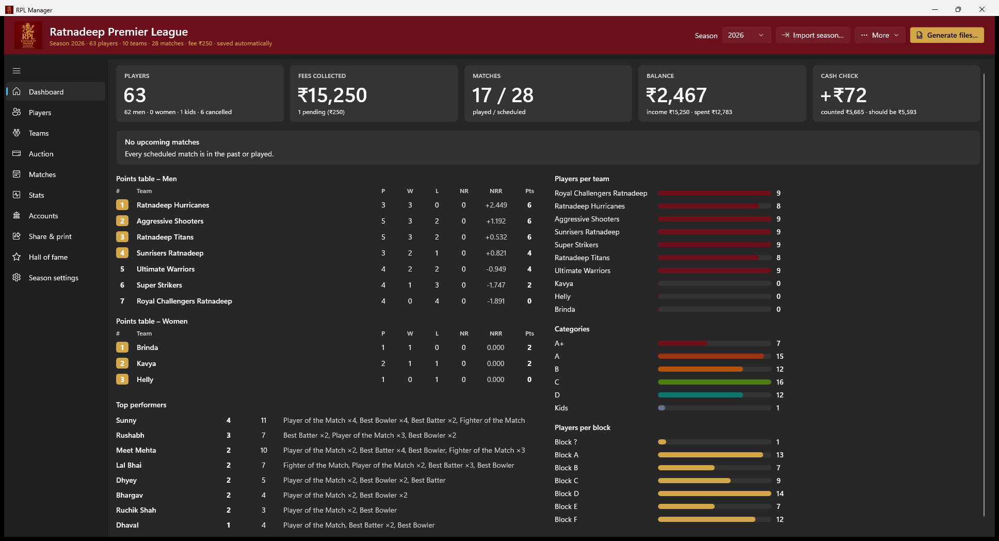
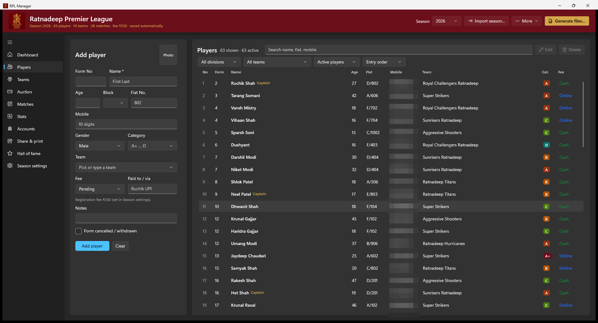
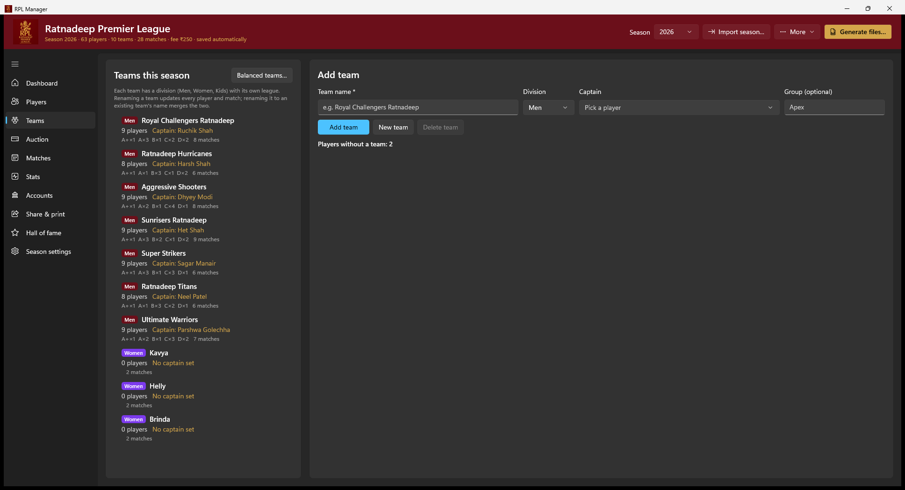
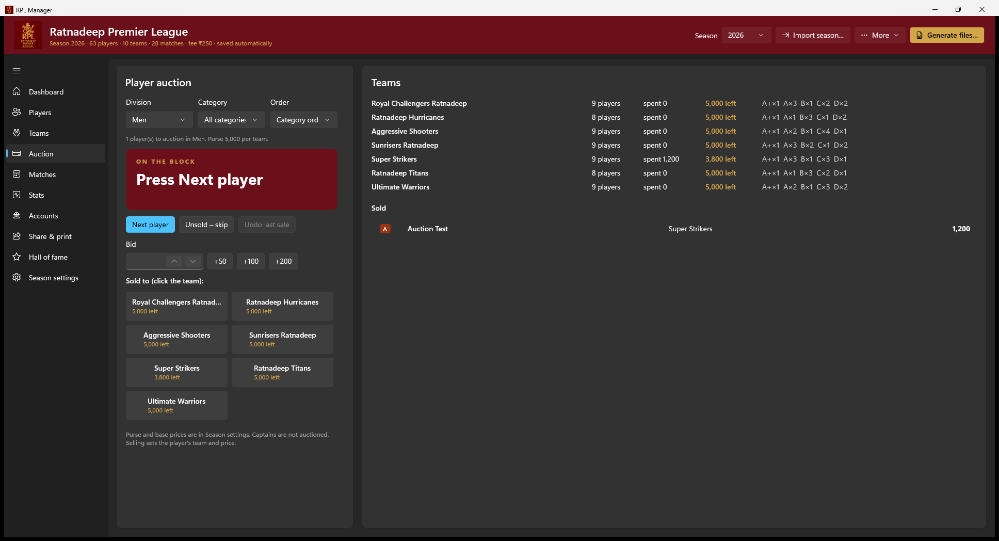
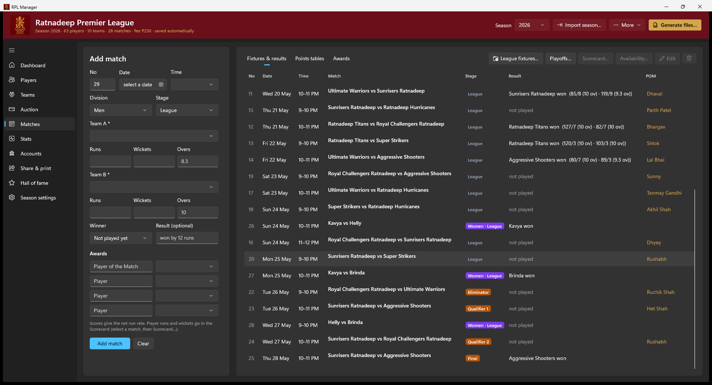
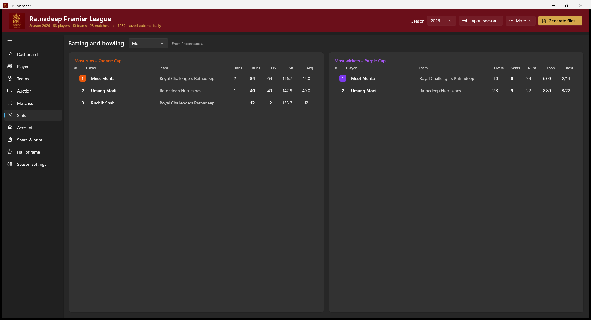
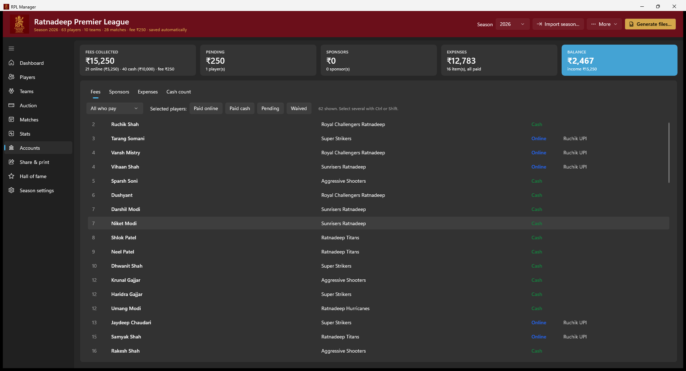
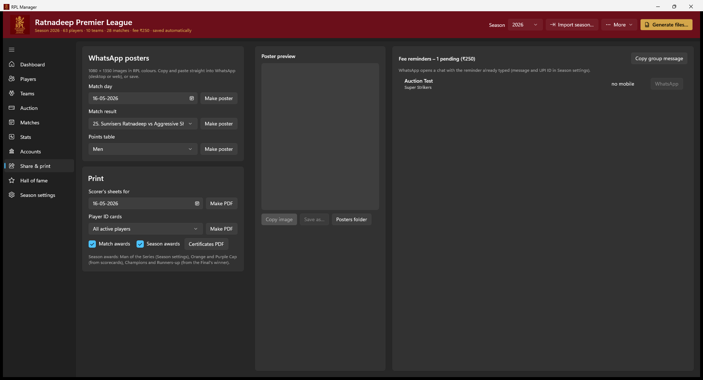
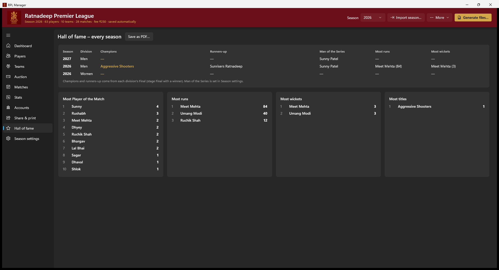
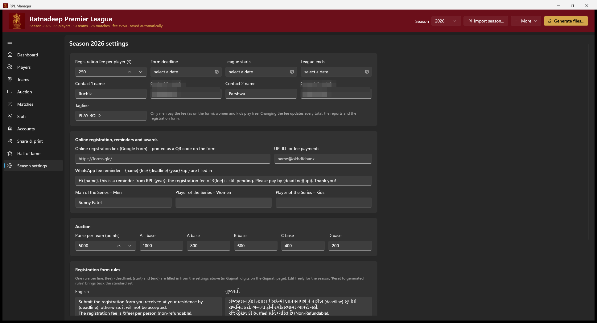

# RPL – Ratnadeep Premier League

Tools for running the residency cricket league, season by season:

- **RPL Manager** (Windows app): register players, set up teams (by hand, balanced automatically or by auction), create fixtures, record scores and awards, and keep the accounts. It makes Excel, CSV, Word and PDF files, the bilingual registration form, team schedules, WhatsApp posters, certificates, ID cards and scorer's sheets. Everything is saved automatically and backed up.
- **Excel template** `Templates\RPL_Template.xltx`: the season workbook (players, accounts, matches, points tables with net run rate). Every total is worked out by formulas, and the fee is one cell.

> Mobile numbers are blurred in all screenshots.



```
RPL/
├── App/                          RPL Manager (WinUI 3, .NET 10)
│   ├── MainWindow.xaml(.cs)      window, dashboard, settings, seasons, generate files
│   ├── MainWindow.Players.cs     players, photos, teams, balanced teams
│   ├── MainWindow.Matches.cs     auction, matches, scorecards, availability, fixtures, stats
│   ├── MainWindow.Share.cs       accounts, posters, WhatsApp reminders, printouts, hall of fame
│   ├── Model.cs                  season, player, team, match, score, performance; lists; rules; form text
│   ├── Calc.cs                   accounts, points tables + NRR, batting/bowling stats, balanced teams,
│   │                             auction purse, hall of fame, fixture generator, playoffs
│   ├── Store.cs                  saved data (rpl.json), seasons, backups and restore
│   ├── Import.cs                 season folder import; Google Form responses (CSV / XLSX)
│   ├── Exporters.cs              Excel (fills the template) and CSV
│   ├── Reports.cs                season report, registration form (with QR), team schedules
│   ├── Printouts.cs              posters, certificates, ID cards, scorer's sheets, hall of fame
│   ├── Office.cs                 Edge PDF/PNG printing, Word conversion, Outlook email, STA helper
│   ├── ViewModels.cs             rows for the lists
│   └── RPL.App.csproj
├── Templates/RPL_Template.xltx
├── Assets/
│   ├── RPL_Logo_classic.png      the RPL logo ("PREMIER" spelling corrected)
│   ├── RPL.ico                   program icon, made from the logo
│   └── Cricket_512.png           batsman artwork on the registration form
├── docs/screenshots/             pictures used in this README
├── Installer/Install.ps1, .cmd   per-user install / uninstall (copied into the published folder)
├── publish.ps1                   build, install on this PC, zip for other PCs
└── README.md
```

## Use it

Open **RPL Manager** from the Start menu or the desktop. To build from source: `dotnet run --project App -c Release`.

`.\publish.ps1` builds the app and installs it for the current Windows user (no admin rights needed):
- the app goes to `%LOCALAPPDATA%\Programs\RPL Manager`;
- shortcuts go on the Start menu and the desktop;
- it appears in **Settings → Apps**, where it can be uninstalled.

League data is kept separately, so installing again or uninstalling never touches it. `-NoInstall` skips installing on this PC.

To give it to another committee member, send `dist\RPLManager.zip`. They unzip it anywhere and double-click `Install.cmd`. Nothing needs installing, but generating files needs Excel (.xlsx), Word (.docx) and Edge (PDFs and posters).

Requires Windows 10 (1809) or later. Building needs the .NET 10 SDK.

## Pages

| Page | What you do there |
|---|---|
| **Dashboard** | Players, fees collected, matches played, balance, cash check; the next match day; points table per division; players per team / category / block; top performers |
| **Players** | The registration form: Form No, name, age, block, flat, mobile, gender, category (A+ to D, Kids), team, fee (Online / Cash / Pending / Waived), paid to, notes, cancelled, photo. Search, filter by division, team or status, sort. Edit (double-click), delete with **Undo**. |
| **Teams** | Teams per division (Men, Women, Kids) with captain and optional group. **Balanced teams…** shares players out fairly. Renaming a team updates every player and match; renaming it to an existing name merges the two. |
| **Auction** | Optional live auction: next player on the block, bid, click the buying team. Purse and base prices per category in Season settings. **Undo last sale** and **Unsold – skip**. |
| **Matches** | Add a match: division, date, time slot, teams, runs / wickets / overs for each side, stage, winner, awards. **Scorecard…** records each player's runs, balls, wickets and overs. **Availability…** marks who can't play. **League fixtures…** and **Playoffs…** build the schedule. Tabs: fixtures & results, points tables, awards. |
| **Stats** | Orange Cap (runs) and Purple Cap (wickets) leaders, batting and bowling tables |
| **Accounts** | Fees (mark selected players paid online / cash / pending / waived), sponsors, expenses, and the cash count by note with the cash check |
| **Share & print** | WhatsApp posters (match day, result, points table), fee reminders, scorer's sheets, player ID cards, award certificates |
| **Hall of fame** | Champions, runners-up, Man of the Series and cap winners of every season, plus all-time leaders |
| **Season settings** | Fee, dates, contacts, tagline, online registration link, UPI ID, reminder message, Man of the Series, auction purse and base prices, and the registration-form rules in English and Gujarati |

| | |
|---|---|
|  |  |
|  |  |
|  |  |
|  |  |



**Data checks on players.**
- The mobile number must be 10 digits, starting with 6–9.
- The app warns about a duplicate mobile or name, a missing mobile, and a team that doesn't exist yet (it is added when you save).

## Divisions: men, women and kids

Every team belongs to a division: **Men**, **Women** or **Kids**. A player's division comes from their gender / category, so women's and kids' games are entered just like men's, with their own players.

- Each division has its own league, fixtures, playoffs and points table.
- The Players page filters by division; the dashboard, report and Excel show one points table per division.
- Only men pay the fee.

## Making teams

Pick one of three ways:

1. **By hand:** choose the team on each player.
2. **Balanced teams…** (Teams page): players are dealt out category by category (A+ first, then A, B …) in snake order, so every team gets a fair mix. Captains stay with their teams. Preview first, then apply.
3. **Auction** (Auction page): players without a team come up one by one; captains are never auctioned. Each team has a purse; the sold price is saved on the player.

The auction is optional. If you don't use it, nothing changes: purse and prices are simply not shown anywhere else.

## Scores, net run rate and stats

Enter runs, wickets and overs for both sides (overs as `8.3` = 8 overs 3 balls). The points table then shows **NRR**:

NRR = runs scored ÷ overs faced − runs conceded ÷ overs bowled

A win scores 2 points and a no-result 1 point. Ties are ordered by NRR, then wins, then fewer losses, then team name, the same as the Excel template. Matches without scores still count for points; NRR is just 0.

**Scorecard…** adds per-player figures. They give the Orange Cap, Purple Cap and the batting / bowling tables on the Stats page.

## Fixtures

**League fixtures…** makes every team in a division (and group) play every other team once:
- **In rounds:** every team plays its next match before any team plays again. With an odd number of teams, one team rests each round.
- **No back-to-back matches:** no team plays twice in one night.
- **Groups:** if teams have a group, each group plays its own league and the groups play side by side.
- **Choices:** you pick the division, the first night and the time slots (9–10 PM, 10–11 PM, …).

The Matches page also checks any fixture list, including imported or typed ones, and warns if a team plays twice in a night.

**Playoffs…** adds four matches from the current top 4 of a division:
1. Qualifier 1 (1st vs 2nd);
2. Eliminator (3rd vs 4th);
3. Qualifier 2 (loser of Q1 vs winner of the Eliminator);
4. the Final.

The Final's winner and loser become the season's champions and runners-up.

**Availability…** on a match records players who can't make it; the dashboard's next-match card lists them.

## Share & print

| Item | What you get |
|---|---|
| **WhatsApp posters** | 1080 × 1350 pictures in RPL colours: match day, match result, points table. **Copy image** and paste into WhatsApp, or save. Saved copies go to `posters\`. |
| **Fee reminders** | Every player with fee pending, each with a **WhatsApp** button that opens a chat with the reminder already typed. The message, with `{name}`, `{fee}`, `{deadline}`, `{year}` and `{upi}`, is set in Season settings. **Copy group message** gives one list for the group. |
| **Scorer's sheets** | One printable sheet per match on the chosen date, with both squads |
| **Player ID cards** | Credit-card size, two across on A4, with photo (if added), team, category and Form No |
| **Certificates** | Match awards (Player of the Match, Best Batter …) and season awards (Man of the Series, Orange / Purple Cap, Champions, Runners-up) |

## Online registration

1. Put the Google Form link in **Season settings → Online registration link**. The registration form then prints a QR code next to the contacts.
2. Download the responses (CSV or XLSX) from Google Forms.
3. **More → Import online registrations…** reads them. Columns are matched by their headings (name, mobile, flat, gender, age …); `+91` is removed and `B-904` is split into block and flat. Players already registered (same mobile or name) are skipped and listed.

## Seasons and the fee

Each season (2026, 2027, …) is separate: its own fee, dates, teams, players, matches and accounts. Pick it in **Season** at the top.

**More → Start new season…** copies the fee, contacts and form rules, and can keep the team names, but starts with no players or matches. For example, 2027 can have a fee of ₹300 while 2026 keeps its own figures.

**The fee** lives in Season settings and can change every season. Only men pay it; women and kids play free, as on the form.

| Figure | How it is worked out |
|---|---|
| Fees collected | players paid online × fee + players paid cash × fee |
| Pending | players still to pay × fee |
| Income | fees collected + sponsors |
| Balance | income − all expenses |
| Cash expected in hand | cash fees + cash sponsors − expenses paid in cash |

The cash check compares the expected cash in hand with the counted notes. For 2026 the books say ₹5,593 should be in hand, and the count adds up to ₹5,665: **₹72 more**.

**Hall of fame** collects each season's champions, runners-up, Man of the Series and caps automatically, and adds up all-time runs, wickets and awards.

## Import a season

**Import season…** reads a folder like `Downloads\New folder\2026`:

| File | Gives |
|---|---|
| `RPL 2026.xlsx` (table **Players**) | players, sponsors, fee, expenses, cash count |
| `RPL_Awards.xlsx` (columns **Match No**, **POM**) | matches and awards |
| `Match.docx` (first table) | each match's date, time slot and stage |

Girls' matches are imported into the Women division.

**After importing 2026:**
- **Link the teams.** The Players sheet names teams by captain (Ruchik, Sagar, …), while the matches use team names. On the Teams page, rename each captain team to its full name (e.g. *Ruchik* → *Royal Challengers Ratnadeep*) and the two merge.
- **Add the winners.** The 2026 files have no match winners; add them on the Matches page to fill the points table.
- **Skipped row.** "Shree Ganesh", the opening entry with no gender, is not imported as a player.

## Generate files

**Generate files…** asks which files to make and then where to save them:

| File | Contents |
|---|---|
| `RPL_2026.xlsx` | Made from the template. Excel itself works out the totals and the points tables. |
| `RPL_2026_players.csv`, `_matches.csv`, `_accounts.csv`, `_stats.csv` | UTF-8, so Gujarati and ₹ show correctly in Excel |
| `RPL_2026_report.docx` / `.pdf` | Season report: cover with totals, points tables with NRR, Orange / Purple Cap, teams & squads, fixtures & results, awards, accounts with cash check, player register |
| `RPL_2026_registration_form.pdf` | Gujarati page and English page, like `RPL_2026.docx`, with this season's fee, dates, rules, contacts and the QR code |
| `RPL_2026_schedules.pdf` | The full schedule by date, then one page per team: its matches (won / lost) and squad |
| Certificates, ID cards, hall of fame | PDFs, as on the Share & print and Hall of fame pages |

Afterwards, **Open folder** shows the files and **Email…** opens an Outlook message with them attached.

**The form rules** are generated (the 2026 rules) and can be edited in Season settings, in English and Gujarati. `{fee}`, `{deadline}`, `{start}` and `{end}` are filled in automatically, in Gujarati digits on the Gujarati page. **Reset to generated rules** brings back the standard set.

**Preview registration form** shows the PDF straight away.

## Saved automatically, with backups

Everything is written to `%LOCALAPPDATA%\RPL\rpl.json` after every change. Player photos are kept in `photos\` and saved posters in `posters\` in the same folder.

Copies go to `backups\` (the latest 60 are kept):
- before the first change of each day;
- before every import, restore, new season and fixture replacement.

**More → Backups and restore…** brings one back; the current data is backed up first. Unexpected errors are written to `error.log` in the same folder. `RPL_DATA_DIR` sets a different data folder.

## Excel template

`Templates\RPL_Template.xltx` is built from `RPL 2026.xlsx`: same Players and Accounts layout and formulas, no players. Changes from the original:

- **Fee:** one cell, Accounts **N2** (yellow), named `Fee`. Every fee total uses it instead of `×250` written into each formula.
- **Lists on the Misc. sheet:** Teams (with captain and division), Category, Block and Stage, editable each season. The dropdowns on Players and Matches use them.
- **New dropdowns:** Block, Gender (now including *Cancelled*), Sponsor, IsOnline, Team (new names allowed) and Category. Mobile numbers must have 10 digits (warning only).
- **Sr No:** one formula for the whole column. In the 2026 file some rows had numbers typed over it.
- **Matches sheet:** one row per match, with division, date, time, teams, stage, winner, result, runs and overs for both sides, and up to three award winners. It replaces the separate awards workbook.
- **Points Table sheet:** one table each for Men, Women and Kids, with net run rate, worked out from Matches and sorted the same way as the app.
- **How to Use sheet** at the front.

Requires Excel for Microsoft 365 or Excel 2024 (the points tables use LET, MAP, LAMBDA, HSTACK and SORTBY).
